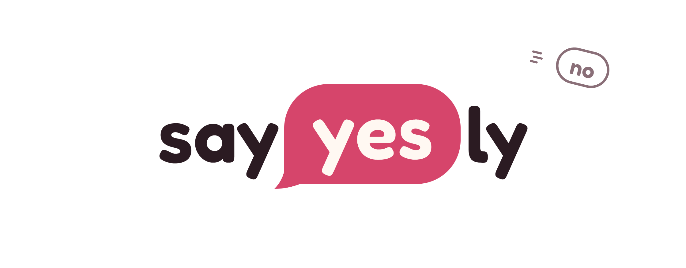
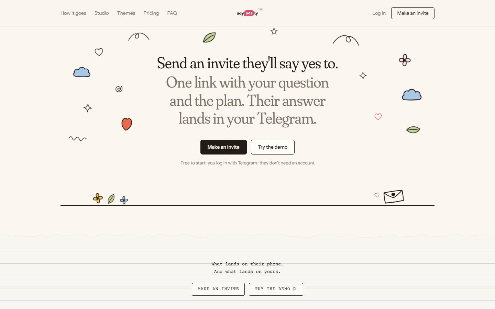
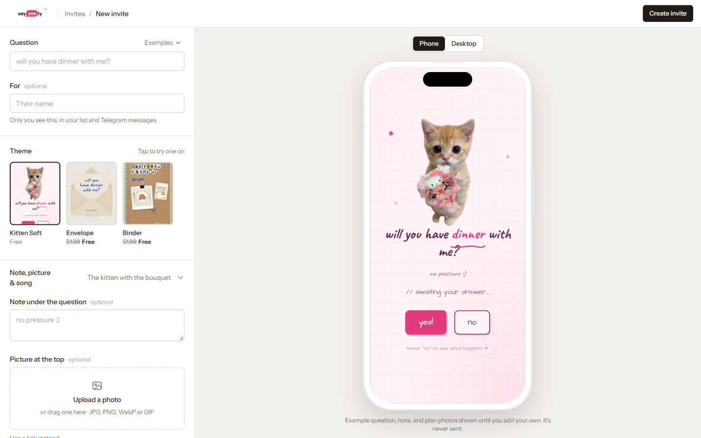
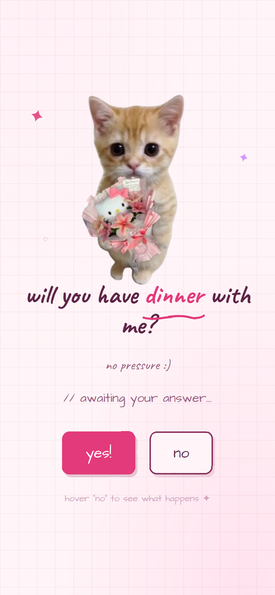
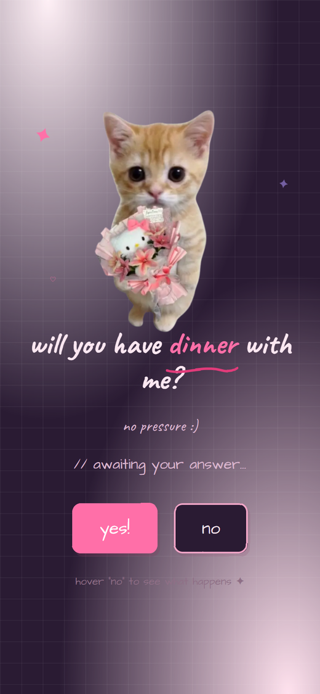
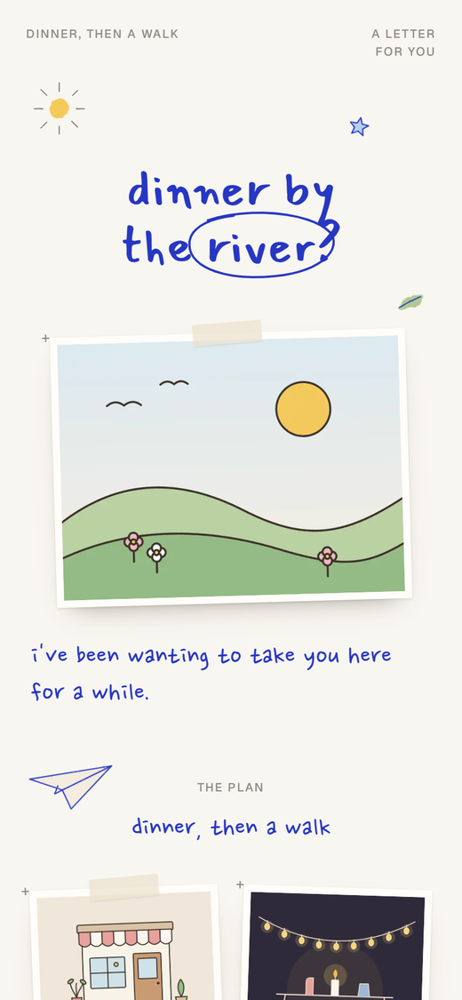
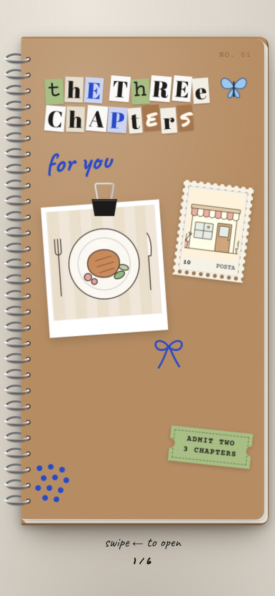

<p align="center">
  
</p>

<p align="center">
  <b>Send an invite they'll say yes to.</b><br />
  One link with your question and the plan. Their answer lands in your Telegram.
</p>

<p align="center">
  <a href="https://sayyesly.site">sayyesly.site</a> ·
  <a href="https://sayyesly.site/demo">Try the demo</a>
</p>



## How it works

1. **A Creator makes an Invite** in the studio: the question, an optional note and picture, the plan (place, photos), the times that work, and a song from YouTube. The phone preview shows exactly what the other person will see, as you type.
2. **They share one link.** The Recipient opens it on their phone, with no account and no app to install.
3. **The Recipient answers**: yes plus a day and a time, or a gentle "maybe another time" in Themes that offer one.
4. **The Answer arrives on Telegram**, in the Creator's DM and in any group chat they linked to the Invite.

Words like Creator, Recipient, Invite, Answer and Theme have exact meanings in this codebase; they're defined in [CONTEXT.md](CONTEXT.md).



## Themes

Each Theme is a complete Recipient experience, written as code. Some are free; paid ones are bought once and paid with any KHQR banking app (through [CutLuy](https://cutluy.com)).

| Kitten Soft | Kitten Night | Envelope | Binder |
|:---:|:---:|:---:|:---:|
|  |  |  |  |
| The "no" button runs away | The kitten, after dark | A sealed letter, answered in ink | A scrapbook binder to page through |

## Features

- **Telegram login and notifications.** Creators log in with Telegram (OpenID Connect). The bot DMs them each Answer, and `/link CODE` in a group chat sends that Invite's news to the whole group.
- **Song.** A YouTube link plays the part the Creator picked, in the background, once the Recipient opens the Invite.
- **Times.** Time slots the Creator offers, plus an optional time of the Recipient's own, in the Creator's time zone.
- **Reopen.** The Creator can clear an Answer so the Invite can be answered again.
- **Paid Themes.** A Theme unlocks only from CutLuy's signature-verified payment webhook, never from anything the browser sends.
- **Link previews.** Each Invite has its own preview image for Telegram and other apps.
- **Rate limits and caching** in Upstash Redis, and privacy-minded analytics in PostHog: events carry ids only, never names, questions or notes.

## Tech stack

| Area | Choice |
|---|---|
| Framework | [Next.js 16](https://nextjs.org) (App Router, Server Actions), React 19, TypeScript (strict) |
| Styling and motion | Tailwind CSS v4, GSAP (landing page) |
| Client state | TanStack Query (server data), React Hook Form + zod (forms), Zustand (shared screen state) |
| Database | PostgreSQL on [Railway](https://railway.com), [Drizzle ORM](https://orm.drizzle.team) |
| Auth | Telegram OpenID Connect, with our own `jose`-signed session cookie |
| Messaging | Telegram Bot API (webhook) |
| Payments | [CutLuy](https://cutluy.com) (KHQR) |
| Storage | Cloudflare R2 for uploaded pictures |
| Rate limits and cache | [Upstash Redis](https://upstash.com) |
| Analytics and errors | [PostHog](https://posthog.com) |
| Hosting | [Vercel](https://vercel.com) |
| Tooling | [Bun](https://bun.sh) (package manager and test runner), ESLint |

## Getting started

You need [Bun](https://bun.sh), a PostgreSQL database and a Telegram bot (from [@BotFather](https://t.me/BotFather)).

```bash
bun install
cp .env.example .env.local   # then fill it in; every variable is explained there
bun run db:migrate           # create the tables
bun run db:seed              # add the Themes and a first Invite
bun dev                      # http://localhost:3000
```

Point `DATABASE_URL` at a database of its own for development, never at production. R2 uploads, Upstash, CutLuy and PostHog are optional locally: without them, pictures are pasted as links, rate limits count in memory, paid Themes can't be bought, and analytics is off.

| Command | What it does |
|---|---|
| `bun dev` | Start the dev server |
| `bun run build` | Production build |
| `bun test` | Unit tests |
| `bun run typecheck` / `bun run lint` | Type check / lint |
| `bun run db:generate` | Generate a migration from the schema |
| `bun run telegram:webhook` | Point the bot at `NEXT_PUBLIC_APP_URL/api/telegram/webhook` |
| `bun run r2:check` | Check the R2 upload setup ([docs/r2-setup.md](docs/r2-setup.md)) |

## Project structure

The code is organised in vertical slices: business logic lives in feature slices, and routes stay thin.

```
src/
  app/                 routes only; they compose slice components
  features/
    invites/           the Invite page, Themes, answers, notifications, the studio
    telegram-bot/      the webhook, /start and /link
    billing/           CutLuy checkout and webhook
    auth/              the login screen
    landing/           the landing page
  lib/                 shared code: database, auth, Telegram, rate limits, cache, analytics…
drizzle/migrations/    database migrations
docs/adr/              architecture decisions, and why they were made
```

The conventions every change follows are in [CLAUDE.md](CLAUDE.md), and the decisions behind them in [docs/adr](docs/adr).

## License

The code is licensed under the [GNU Affero General Public License v3.0](LICENSE) (AGPL-3.0-only). The sayyesly name, logo and the images in this repository are **not** covered by that license; see [NOTICE.md](NOTICE.md).
